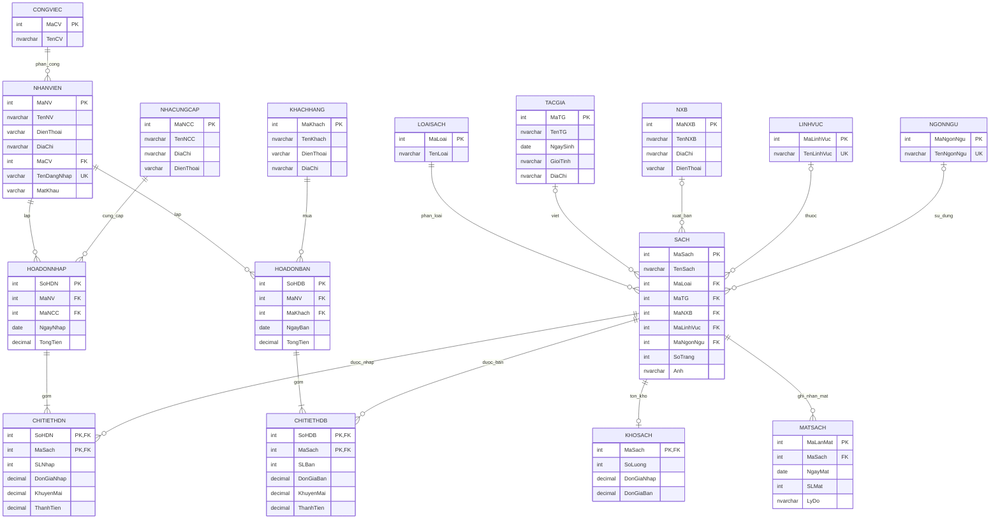
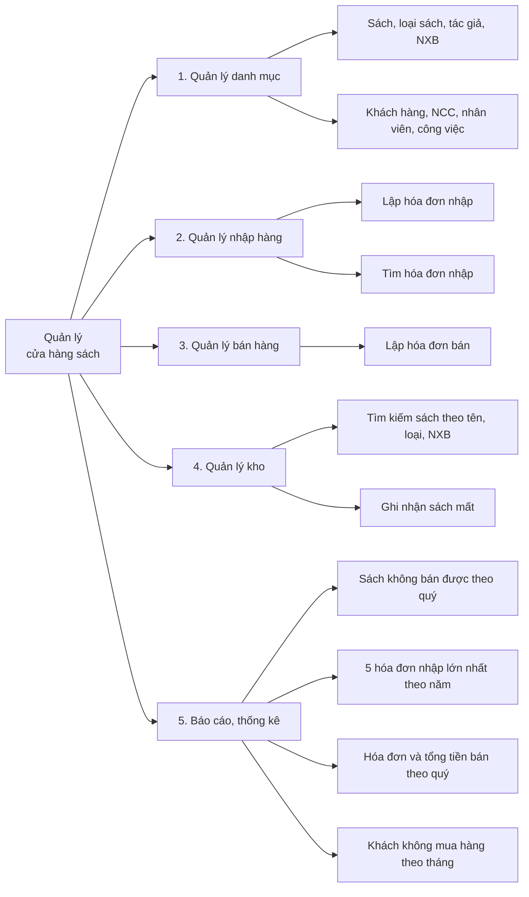
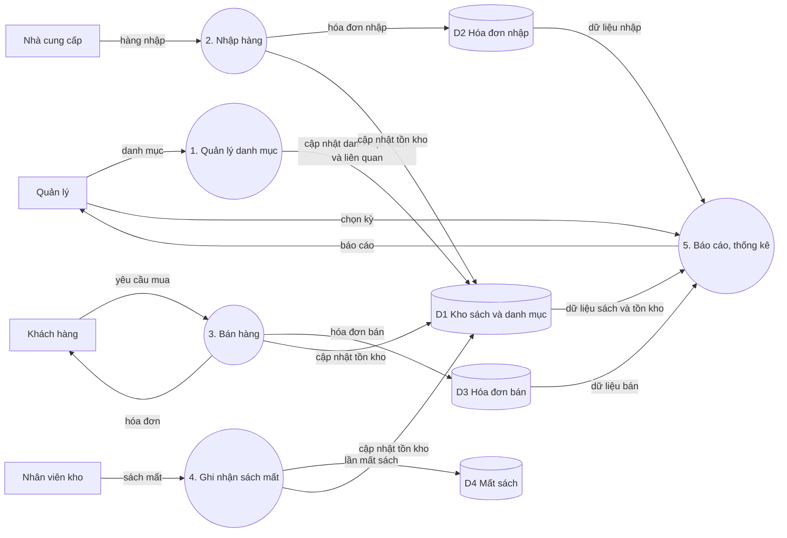

# Sơ đồ hệ thống quản lý cửa hàng sách

Các sơ đồ dưới đây được xây dựng theo database `QLCuaHangSach` và các chức năng hiện có trong ứng dụng WinForms.

## 1. ERD – Mô hình thực thể liên kết

**Ghi chú:** `ChiTietHDN` và `ChiTietHDB` có khóa chính ghép từ mã hóa đơn và mã sách. Số lượng tồn kho được theo dõi tại `KhoSach`; trigger cập nhật tồn khi phát sinh nhập, bán hoặc ghi nhận mất sách.

## 2. BFD – Sơ đồ phân rã chức năng

Hệ thống gồm 5 nhóm chức năng và 11 chức năng con, theo phạm vi sơ đồ mẫu.

## 3. DFD – Sơ đồ luồng dữ liệu

### 3.1. DFD mức 1

Quy ước: hình chữ nhật là tác nhân ngoài, tiến trình được đánh số, kho dữ liệu ký hiệu D1–D4. Nhập hàng, bán hàng và ghi nhận sách mất đều cập nhật kho D1; báo cáo chỉ đọc dữ liệu.

